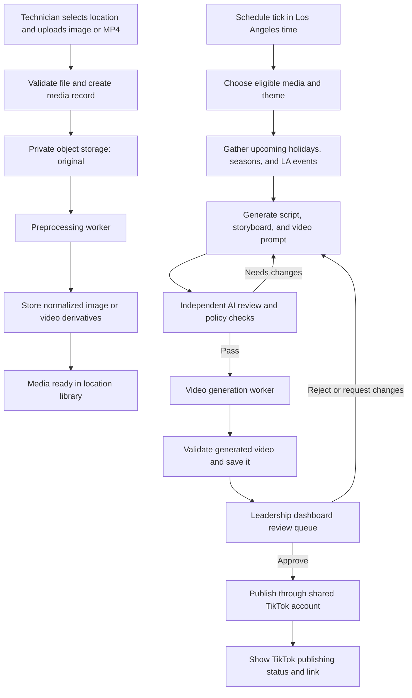

# BellaCure Salon Content Pipeline

## Goal

Create a multi-location workflow where salon technicians upload source photos or MP4 clips, and a scheduled AI pipeline turns approved media into short, salon-themed TikTok videos. Content is organized by seven salon locations. A schedule selects a seasonal, holiday, or Los Angeles event theme; AI drafts a script, storyboard, and generation prompt; a separate reviewer checks the creative brief; and a video model generates the final clip.

The product has two role-focused dashboards: a technician dashboard for uploading and tracking media, and a leadership dashboard for monitoring jobs, reviewing generated videos, and approving publication. Videos are never published without an authorized human approval.

## Recommended system shape

- **Web app:** Next.js application with a technician upload dashboard, location-scoped media library, schedule configuration, and a leadership dashboard for job monitoring, review, approval, and TikTok publishing.
- **Application API:** Authenticated server endpoints for uploads, job creation, schedule management, approvals, and provider callbacks.
- **Application backend:** Supabase Auth for sign-in, PostgreSQL for application data, and private Supabase Storage buckets for originals, normalized derivatives, and generated videos. Store object keys and metadata in PostgreSQL, not media bytes.
- **Billing:** The service operator's Stripe account sells subscriptions to salon locations. Stripe Checkout handles sign-up and Stripe's customer portal handles payment-method and subscription self-service.
- **Social publishing:** One shared, salon-owned TikTok account is connected through TikTok's supported publishing integration. Only approved videos can enter the publishing queue.
- **Background processing:** Durable queue and workers for media preprocessing, creative generation, and video generation. Use retries with backoff, idempotent jobs, and dead-letter handling.
- **Provider adapters:** Keep image/video processing, language models, event feeds, and video-generation APIs behind interfaces so vendors can be changed without changing the workflow.

The application is designed for one salon business with seven locations initially, but the tenant model should support additional salon businesses. Each location has its own subscription. The seven locations initially publish through one shared TikTok account. Stripe Connect is not needed when subscription payments go to the service operator; consider Connect only if salons later need to receive payouts through the product.

The hosting provider and worker queue are still undecided. Keep Stripe secret credentials and webhook signing secrets, Supabase server credentials, and AI provider keys in the deployment's secrets manager. Configure account credentials per environment; never commit them or expose server credentials to the browser.

## End-to-end workflow

## Role-based dashboards

### Technician upload dashboard

- Sign in and select an authorized salon location.
- Upload supported images and MP4 videos with clear file, duration, and size requirements; show upload progress and validation errors.
- Browse that location's originals and processed derivatives, with processing state, retryable failures, and whether each asset is eligible for AI use.
- Track jobs using the technician's assets through preprocessing and generation without exposing other locations' media, billing data, or leadership-only approval controls.

### Leadership operations and review dashboard

- Provide authorized leadership with a cross-location overview of active subscriptions, queued/running/failed jobs, jobs awaiting review, approved posts awaiting publication, and recently published videos. Scope the overview to the leader's permitted salon account.
- Offer queue filters for location, schedule, job state, theme, date, and assignee; show stage, progress, timestamps, attempts, and actionable failure details. Support safe retry or cancellation where appropriate.
- In the review workspace, show the finished video alongside source assets, location, selected theme/event context, storyboard and prompt, AI review result, and automated no-text/no-speech validation.
- Allow leadership to approve, reject with a reason, or request a bounded regeneration. Require explicit confirmation before publishing; record approver, timestamp, destination, and approved artifact version.
- Show publication progress and the TikTok post URL when available. Clearly distinguish generated, awaiting review, approved, publishing, published, and failed states.

### TikTok publishing

- Connect one shared salon-owned TikTok account using TikTok's current supported OAuth and content-publishing flow. Confirm the app's API access, review/approval requirements, account eligibility, and permitted visibility options before promising automated publication.
- Keep access/refresh tokens and signing credentials server-side in a secrets manager or appropriately encrypted credential store. Never expose them to the browser or place them in prompts/logs.
- Publishing is a separate job created only from an explicit leadership approval for a specific immutable video version and destination account. Re-check the approver's account permission and the location's active subscription before enqueueing.
- Track provider post IDs, status, response/errors, and published URL. Make submission idempotent where the API permits; if an outcome is ambiguous, reconcile provider status before retrying to avoid duplicate posts.
- Do not silently publish a replacement after regeneration: every changed video requires a new review and approval. Preserve a manual download/export path if API access is unavailable or publishing fails.

## Upload and preprocessing

1. The technician signs in, selects one of the seven configured locations, and uploads an image or MP4. Location membership is checked on the server; a client-supplied location ID is never authorization.
2. The API validates file type using content inspection, size, duration, and image/video dimensions. It creates a media row with an upload state and returns a short-lived, restricted upload URL.
3. The original is stored privately and retained unchanged. A completed upload enqueues a preprocessing job.
4. Preprocessing creates normalized derivatives: orientation-corrected and web-sized images, plus MP4 clips normalized to supported codecs, dimensions, frame rate, and duration. Optional background removal or visual filters are non-destructive derived variants, not replacements for the original.
5. The worker records derivative keys, processing results, and errors, and marks the media `ready` or `failed`. A technician can see failures and retry eligible jobs.

Background removal and filters should be optional processing steps controlled by configuration. They can alter nail color or detail, so retain the original and make each effect inspectable before it is used in a generated video.

## Schedule, themes, and Los Angeles context

- Store schedules in the salon's configured timezone, initially `America/Los_Angeles`; use UTC timestamps for persisted execution times and convert at the scheduling boundary.
- Support an explicit cadence and a configurable daily/weekly generation limit. A schedule run must be idempotent so a retry cannot create duplicate video jobs.
- A theme selector considers the date, season, configured holidays, and curated upcoming Los Angeles-area events. Use an event feed only when its licensing, reliability, and update cadence are acceptable; otherwise maintain a curated event table with start/end dates, location, category, source, and last-verified time.
- Treat event data as creative context, not as guaranteed truth. Exclude stale or unverified events, and do not imply salon sponsorship or affiliation with an event.
- Each schedule run records why it selected the theme and which event/calendar records informed the brief.
- Select only ready media that the location has made available for AI use. Avoid repeatedly using the same asset by recording its use history and applying a configurable cooldown.

## AI creation and review

Use separate, versioned workflow stages so each output can be inspected and retried:

1. **Brief:** Inputs include the location's brand settings, eligible media, target duration/aspect ratio, selected theme, and relevant event context.
2. **Creative draft:** Generate a short-form script, shot-by-shot storyboard, and a structured video-generation prompt. The script is planning metadata only; it is not rendered as on-screen text or voiceover.
3. **Independent review:** A separate model reviews the storyboard and prompt against brand fit, salon relevance, source-media consistency, event accuracy, safety, and format constraints. It returns structured `pass` or `revise` results with reasons. Bound revision attempts; after the limit, stop for human review rather than looping indefinitely.
4. **Video generation:** Submit only a passing, versioned prompt and selected assets. Persist the provider job ID and poll or consume callbacks through an idempotent handler.
5. **Output checks:** Verify the result is a readable video, meets duration/aspect-ratio requirements, and has no detectable speech or unwanted text. Because model instructions are not guarantees, send uncertain or failed checks to a person and do not mark them approved automatically.
6. **Human review:** Present the generated video, source assets, theme, script/storyboard, reviewer decision, and processing history. An authorized person can approve, reject, or request a regeneration.

Prompts and provider requests must explicitly require: nail-salon imagery and subject matter; no captions, titles, logos, watermarks, or other generated text; no dialogue, narration, singing, or audible speech; and no people speaking. Prefer instrumental or no audio where supported. Preserve provider moderation results and make prompt/model versions auditable.

## Core data model

| Entity | Purpose and important fields |
|---|---|
| `salon_accounts` | Tenant/business record; name, account owner, status |
| `locations` | Salon branches belonging to an account; name, timezone, brand settings, active status |
| `users`, `location_memberships` | Identity, role, and locations the user may access |
| `billing_subscriptions` | Location, Stripe customer/subscription/price IDs, internal status, current period end, cancellation state, last synced time |
| `stripe_webhook_events` | Stripe event ID, type, received/processed timestamps, processing status, and safe error details for idempotent handling |
| `media_assets` | Location, uploader, original object key, media type, metadata, consent/AI-use state, lifecycle status |
| `media_derivatives` | Parent asset, derivative type, object key, processing version, status |
| `schedules` | Location, cadence, local time, enabled state, limits, theme preferences |
| `events` | Event name, dates, geography, category, source, verification timestamp |
| `content_jobs` | Schedule run, location, selected assets, theme, state, attempt count, timestamps |
| `creative_artifacts` | Brief, script, storyboard, prompt, reviewer output, model/provider versions |
| `generated_videos` | Job, object key, provider job ID, validation results, review decision |
| `social_accounts` | Salon account, provider, connected account identifier, connection state, secret reference; never store publish tokens in client-readable rows |
| `publication_jobs` | Approved video version, destination account, approver, state, provider post ID/URL, attempts, timestamps, error details |
| `audit_events` | Actor, action, entity, timestamp, and relevant change metadata |

Use foreign keys and indexes for location-scoped queries and job polling. Keep large media out of database rows. Apply a documented retention policy to originals, derivatives, prompts, and rejected generations.

## Supabase and Stripe integration

- Supabase is the application's system of record for salon accounts, location membership, media metadata, schedules, generation jobs, and the locally synchronized subscription entitlements. Supabase Auth identifies users; PostgreSQL Row Level Security (RLS) enforces salon-account and location access. Never treat a user-editable profile field or client-supplied location ID as proof of authorization.
- Enable RLS on every exposed application table and storage bucket. Policies must check the user's server-managed membership and role for the relevant salon account/location. Keep Stripe IDs and billing state read-only to client roles; only the trusted billing backend may update them.
- Store uploaded and generated media in private buckets. Authorize access against location membership and issue short-lived signed URLs rather than making media public.
- Create one Stripe customer per salon business and one Stripe subscription per paid location. A Checkout Session is created server-side for the chosen location and price; use trusted server-side records/metadata to map the resulting Stripe subscription back to that location. Never accept a client-provided Stripe customer, price, subscription, or entitlement as authoritative.
- Add a server-side Stripe webhook endpoint. Verify the Stripe signature against the raw request body, persist each event ID before processing, and make processing idempotent. Handle subscription create/update/delete and invoice paid/payment-failed events; safely account for retries and out-of-order delivery, and reconcile against Stripe's canonical subscription state before changing access.
- The verified billing state controls location-level entitlements, including whether that location can upload media, run scheduled generation, or use other paid features. The browser may display subscription status but cannot grant access. Define the payment-failure grace period and cancellation cutoff before launch.
- Provide a link to Stripe's hosted customer portal for billing self-service. Do not handle or store card numbers in the application. The product's Stripe account is for collecting SaaS fees; Stripe Connect is only needed if the product later routes money to salons.

## Suggested API surface

- `POST /api/uploads` — authorize a location and create a restricted upload target.
- `POST /api/media/{id}/complete` — verify upload completion and enqueue preprocessing.
- `GET /api/media` — list assets only from locations accessible to the caller.
- `POST /api/billing/checkout` — create a server-authorized Checkout Session for a location and configured price.
- `POST /api/billing/portal` — create a customer portal session for the authenticated salon account.
- `POST /api/stripe/webhook` — verify, persist, and idempotently process Stripe billing events.
- `POST /api/schedules` / `PATCH /api/schedules/{id}` — create and manage location schedules.
- `POST /api/content-jobs` — request an authorized one-off run or enqueue a scheduled run.
- `GET /api/content-jobs/{id}` — return state and review artifacts.
- `POST /api/generated-videos/{id}/review` — approve, reject, or request regeneration.
- `POST /api/social/connect` — begin authorized connection of the shared salon TikTok account.
- `POST /api/generated-videos/{id}/publish` — create a publication job only after verifying explicit leadership approval and destination authorization.
- `GET /api/publication-jobs/{id}` — return publication state and provider URL/error details.
- `POST /api/providers/{provider}/callback` — authenticate and idempotently process provider callbacks.

Worker-only operations should use service credentials and must not be exposed as unrestricted client endpoints.

## Job states and reliability

Represent the content job as explicit states, for example: `queued`, `preprocessing`, `ready_for_brief`, `drafting`, `reviewing`, `generating`, `validating`, `awaiting_human_review`, `approved`, `rejected`, and `failed`. Track publication as its own state machine, for example: `not_requested`, `queued`, `publishing`, `published`, and `failed`, linked to the exact approved video version. Persist stage transitions and error details. Retry transient provider/network failures with capped exponential backoff; do not retry invalid media or policy failures blindly. Use an idempotency key per scheduled run and per provider submission. Configure a maximum generation/revision budget per location and alert on exhausted jobs.

## Security, privacy, and operational controls

- Enforce role and location access on every API and storage operation. Use private buckets, short-lived signed URLs, encryption in transit/at rest, and least-privilege worker credentials.
- Enforce tenant and location boundaries in Supabase RLS as well as in API authorization. Keep Supabase server credentials and Stripe secret/webhook keys server-side only; expose only Supabase's client-safe project configuration to the browser.
- Verify Stripe webhook signatures and provider callbacks, persist event IDs for idempotency, rate-limit upload and generation endpoints, and record audit events for approvals, access changes, billing changes, and AI generation.
- Get appropriate consent before uploading identifiable customer media. Provide deletion workflows for originals and derivatives and confirm each AI provider's retention/training terms before sending salon content.
- Store API credentials in a secrets manager. Do not put secrets in prompts, browser code, database logs, or source control.
- Track queue depth, stage latency, provider errors, retry counts, generation spend, and failed content checks. Provide a per-location kill switch for scheduled generation.
- Apply provider-specific content and data-handling policies before sending any image or video to a third party.

## Delivery plan

1. **Accounts and billing foundation:** Configure the Supabase project, salon-account/location tenancy, Auth, RLS, private storage, Stripe products/prices, location subscription checkout, webhook synchronization, and billing tests.
2. **Media processing:** Add validation, image/video normalization, derived-asset storage, status reporting, and retry controls.
3. **Scheduled creative:** Add schedule configuration, curated LA event/holiday data, asset selection, script/storyboard drafting, and independent review.
4. **Operations dashboards:** Add the technician upload dashboard and leadership cross-location job queue, review workspace, approval audit trail, and publication status.
5. **Video generation and publishing:** Add one video provider, output validation, generation budgets, human approval, shared TikTok account connection, and publishing with a manual export fallback.
6. **Production hardening:** Add billing recovery/access policies, monitoring, deletion/retention controls, provider failover decisions, load/cost testing, and a limited pilot across locations.

## Decisions required before implementation

- Hosting/cloud and managed database/object-storage/queue vendor.
- Whether a failed payment triggers a grace period, what features remain available during it, and when canceled access ends.
- Per-location product tiers, pricing, trial policy, and who is allowed to start or cancel a location subscription.
- TikTok developer app/API eligibility, review requirements, supported post types and visibility, and the person responsible for connecting the shared account.
- AI text/review and video-generation providers, including data retention and commercial-use terms.
- Whether technician uploads may include identifiable customers, and the required consent/retention policy.
- Schedule cadence and per-location generation budget.
- Event source versus a curated Los Angeles calendar, and who maintains it.
- Leadership approval roles, whether publication is immediate or scheduled after approval, and the fallback process if TikTok publishing is unavailable.
