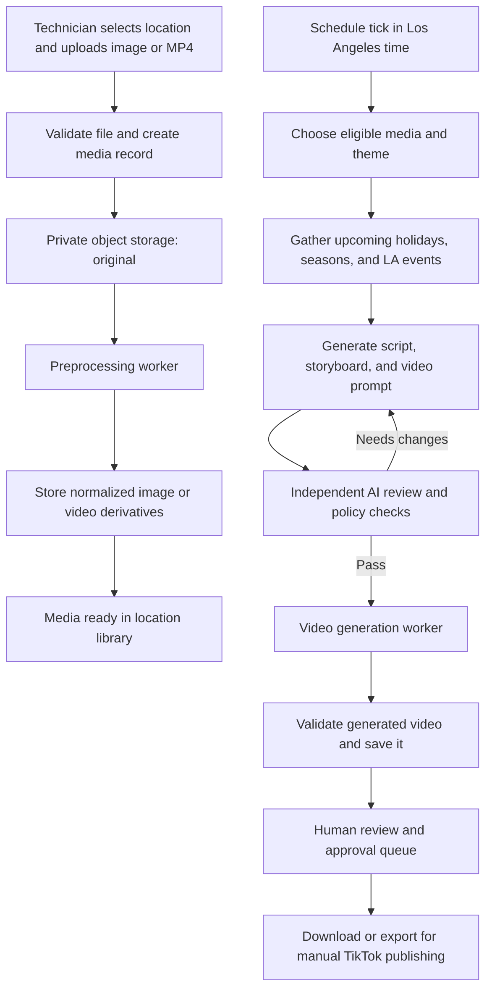

# BellaCure Salon Content Pipeline

## Goal

Create a multi-location workflow where salon technicians upload source photos or MP4 clips, and a scheduled AI pipeline turns approved media into short, salon-themed TikTok videos. Content is organized by seven salon locations. A schedule selects a seasonal, holiday, or Los Angeles event theme; AI drafts a script, storyboard, and generation prompt; a separate reviewer checks the creative brief; and a video model generates the final clip.

The initial product should create and queue videos for human review. It should not publish to TikTok automatically.

## Recommended system shape

- **Web app:** Next.js application for technician uploads, location-scoped media library, schedule configuration, and a generated-content review queue.
- **Application API:** Authenticated server endpoints for uploads, job creation, schedule management, approvals, and provider callbacks.
- **Database:** Managed PostgreSQL for locations, users, media metadata, schedules, events, jobs, prompts, review results, and generated outputs.
- **Object storage:** Private S3-compatible bucket for originals, normalized derivatives, and generated videos. Store object keys and metadata in PostgreSQL, not media bytes.
- **Background processing:** Durable queue and workers for media preprocessing, creative generation, and video generation. Use retries with backoff, idempotent jobs, and dead-letter handling.
- **Provider adapters:** Keep image/video processing, language models, event feeds, and video-generation APIs behind interfaces so vendors can be changed without changing the workflow.

The deployment provider is intentionally undecided. Choose managed services that provide private object storage, PostgreSQL, a durable queue, and secrets management in the target cloud.

## End-to-end workflow

## Upload and preprocessing

1. The technician signs in, selects one of the seven configured locations, and uploads an image or MP4. Location membership is checked on the server; a client-supplied location ID is never authorization.
2. The API validates file type using content inspection, size, duration, and image/video dimensions. It creates a media row with an upload state and returns a short-lived, restricted upload URL.
3. The original is stored privately and retained unchanged. A completed upload enqueues a preprocessing job.
4. Preprocessing creates normalized derivatives: orientation-corrected and web-sized images, plus MP4 clips normalized to supported codecs, dimensions, frame rate, and duration. Optional background removal or visual filters are non-destructive derived variants, not replacements for the original.
5. The worker records derivative keys, processing results, and errors, and marks the media `ready` or `failed`. A technician can see failures and retry eligible jobs.

Background removal and filters should be optional processing steps controlled by configuration. They can alter nail color or detail, so retain the original and make each effect inspectable before it is used in a generated video.

## Schedule, themes, and Los Angeles context

- Store schedules in the salon's configured timezone, initially `America/Los_Angeles`; use UTC timestamps for persisted execution times and convert at the scheduling boundary.
- Support an explicit cadence and a configurable daily/weekly generation limit. A schedule run must be idempotent so a retry cannot create duplicate video jobs.
- A theme selector considers the date, season, configured holidays, and curated upcoming Los Angeles-area events. Use an event feed only when its licensing, reliability, and update cadence are acceptable; otherwise maintain a curated event table with start/end dates, location, category, source, and last-verified time.
- Treat event data as creative context, not as guaranteed truth. Exclude stale or unverified events, and do not imply salon sponsorship or affiliation with an event.
- Each schedule run records why it selected the theme and which event/calendar records informed the brief.
- Select only ready media that the location has made available for AI use. Avoid repeatedly using the same asset by recording its use history and applying a configurable cooldown.

## AI creation and review

Use separate, versioned workflow stages so each output can be inspected and retried:

1. **Brief:** Inputs include the location's brand settings, eligible media, target duration/aspect ratio, selected theme, and relevant event context.
2. **Creative draft:** Generate a short-form script, shot-by-shot storyboard, and a structured video-generation prompt. The script is planning metadata only; it is not rendered as on-screen text or voiceover.
3. **Independent review:** A separate model reviews the storyboard and prompt against brand fit, salon relevance, source-media consistency, event accuracy, safety, and format constraints. It returns structured `pass` or `revise` results with reasons. Bound revision attempts; after the limit, stop for human review rather than looping indefinitely.
4. **Video generation:** Submit only a passing, versioned prompt and selected assets. Persist the provider job ID and poll or consume callbacks through an idempotent handler.
5. **Output checks:** Verify the result is a readable video, meets duration/aspect-ratio requirements, and has no detectable speech or unwanted text. Because model instructions are not guarantees, send uncertain or failed checks to a person and do not mark them approved automatically.
6. **Human review:** Present the generated video, source assets, theme, script/storyboard, reviewer decision, and processing history. An authorized person can approve, reject, or request a regeneration.

Prompts and provider requests must explicitly require: nail-salon imagery and subject matter; no captions, titles, logos, watermarks, or other generated text; no dialogue, narration, singing, or audible speech; and no people speaking. Prefer instrumental or no audio where supported. Preserve provider moderation results and make prompt/model versions auditable.

## Core data model

| Entity | Purpose and important fields |
|---|---|
| `locations` | Seven salon branches; name, timezone, brand settings, active status |
| `users`, `location_memberships` | Identity, role, and locations the user may access |
| `media_assets` | Location, uploader, original object key, media type, metadata, consent/AI-use state, lifecycle status |
| `media_derivatives` | Parent asset, derivative type, object key, processing version, status |
| `schedules` | Location, cadence, local time, enabled state, limits, theme preferences |
| `events` | Event name, dates, geography, category, source, verification timestamp |
| `content_jobs` | Schedule run, location, selected assets, theme, state, attempt count, timestamps |
| `creative_artifacts` | Brief, script, storyboard, prompt, reviewer output, model/provider versions |
| `generated_videos` | Job, object key, provider job ID, validation results, review decision |
| `audit_events` | Actor, action, entity, timestamp, and relevant change metadata |

Use foreign keys and indexes for location-scoped queries and job polling. Keep large media out of database rows. Apply a documented retention policy to originals, derivatives, prompts, and rejected generations.

## Suggested API surface

- `POST /api/uploads` — authorize a location and create a restricted upload target.
- `POST /api/media/{id}/complete` — verify upload completion and enqueue preprocessing.
- `GET /api/media` — list assets only from locations accessible to the caller.
- `POST /api/schedules` / `PATCH /api/schedules/{id}` — create and manage location schedules.
- `POST /api/content-jobs` — request an authorized one-off run or enqueue a scheduled run.
- `GET /api/content-jobs/{id}` — return state and review artifacts.
- `POST /api/generated-videos/{id}/review` — approve, reject, or request regeneration.
- `POST /api/providers/{provider}/callback` — authenticate and idempotently process provider callbacks.

Worker-only operations should use service credentials and must not be exposed as unrestricted client endpoints.

## Job states and reliability

Represent the job as explicit states, for example: `queued`, `preprocessing`, `ready_for_brief`, `drafting`, `reviewing`, `generating`, `validating`, `awaiting_human_review`, `approved`, `rejected`, and `failed`. Persist stage transitions and error details. Retry transient provider/network failures with capped exponential backoff; do not retry invalid media or policy failures blindly. Use an idempotency key per scheduled run and per provider submission. Configure a maximum generation/revision budget per location and alert on exhausted jobs.

## Security, privacy, and operational controls

- Enforce role and location access on every API and storage operation. Use private buckets, short-lived signed URLs, encryption in transit/at rest, and least-privilege worker credentials.
- Validate uploads and generated provider callbacks; rate-limit upload and generation endpoints; record audit events for approvals, access changes, and AI generation.
- Get appropriate consent before uploading identifiable customer media. Provide deletion workflows for originals and derivatives and confirm each AI provider's retention/training terms before sending salon content.
- Store API credentials in a secrets manager. Do not put secrets in prompts, browser code, database logs, or source control.
- Track queue depth, stage latency, provider errors, retry counts, generation spend, and failed content checks. Provide a per-location kill switch for scheduled generation.
- Apply provider-specific content and data-handling policies before sending any image or video to a third party.

## Delivery plan

1. **Foundation:** Configure the seven locations, authentication/roles, private storage, database, upload flow, and location-scoped media library.
2. **Media processing:** Add validation, image/video normalization, derived-asset storage, status reporting, and retry controls.
3. **Scheduled creative:** Add schedule configuration, curated LA event/holiday data, asset selection, script/storyboard drafting, and independent review.
4. **Video generation and review:** Add one video provider, output validation, generation budgets, and human approval/export.
5. **Production hardening:** Add monitoring, deletion/retention controls, provider failover decisions, load/cost testing, and a limited pilot across locations.

## Decisions required before implementation

- Hosting/cloud and managed database/object-storage/queue vendor.
- AI text/review and video-generation providers, including data retention and commercial-use terms.
- Whether technician uploads may include identifiable customers, and the required consent/retention policy.
- Schedule cadence and per-location generation budget.
- Event source versus a curated Los Angeles calendar, and who maintains it.
- Approval roles and whether approved videos are exported manually or eventually published through a supported social API.
